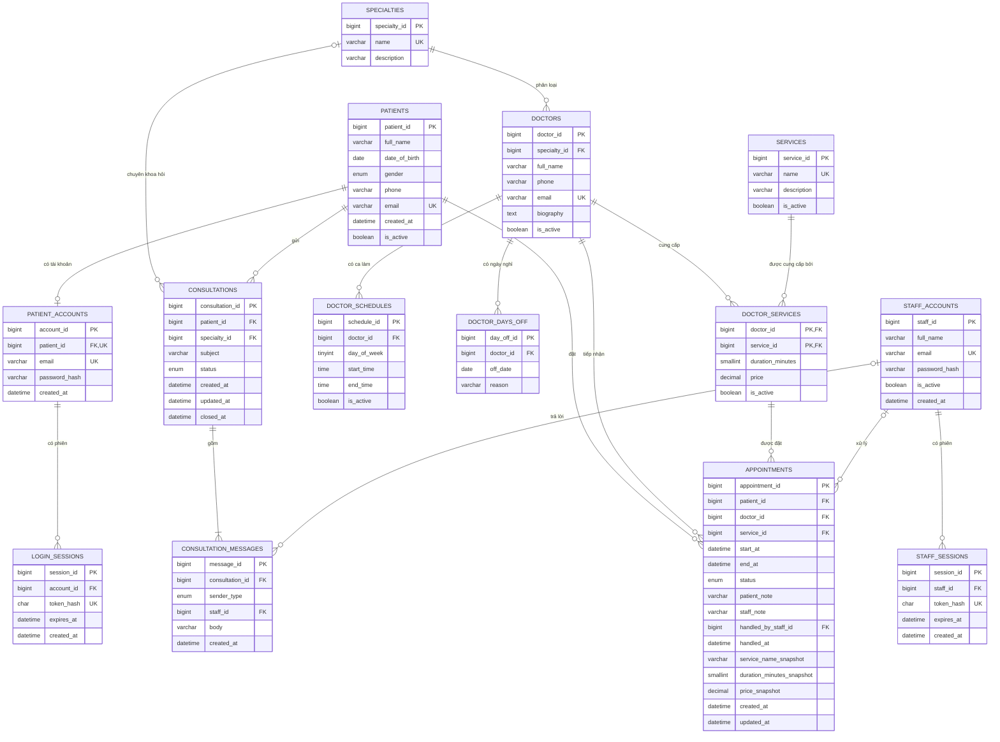

# Đặc tả và thiết kế CSDL

## 02. Yêu cầu: User Story

Các vai trò: **Khách** (chưa đăng nhập), **Bệnh nhân** (có tài khoản) và **Nhân viên phòng khám**
(tài khoản riêng, do quản trị tạo, không đăng ký công khai).

### Bệnh nhân

| ID | User Story | Tiêu chí chấp nhận |
|---|---|---|
| US-01 | Là khách truy cập, tôi muốn xem dịch vụ, giá, thời lượng và bác sĩ để chọn dịch vụ phù hợp. | Chỉ hiển thị dịch vụ/bác sĩ đang hoạt động. Danh mục xem được mà không cần tài khoản. |
| US-02 | Là bệnh nhân mới, tôi muốn đăng ký tài khoản bằng họ tên, điện thoại, email và mật khẩu để dùng dịch vụ trực tuyến. | Email không trùng; số điện thoại đúng định dạng; mật khẩu tối thiểu 10 ký tự và được băm trước khi lưu. |
| US-03 | Là bệnh nhân, tôi muốn đăng nhập và đăng xuất an toàn để truy cập dữ liệu cá nhân. | API tạo phiên ngẫu nhiên, gửi trong cookie `HttpOnly`, và thu hồi phiên khi đăng xuất. |
| US-04 | Là bệnh nhân đã đăng nhập, tôi muốn đặt lịch bằng hồ sơ tài khoản của mình để không phải nhập lại thông tin. | Máy chủ lấy `patient_id` từ phiên đăng nhập; kiểm tra thời gian tương lai, ca làm, ngày nghỉ và lịch trùng; lịch mới ở trạng thái `pending`. |
| US-05 | Là bệnh nhân, tôi muốn xem lịch hẹn riêng của mình để theo dõi tình trạng thăm khám. | Truy vấn luôn có điều kiện `appointments.patient_id = patient_id` của phiên; không nhận patient ID từ trình duyệt. |
| US-06 | Là bệnh nhân, tôi muốn hủy lịch sắp tới của mình khi không thể đến khám. | Chỉ tài khoản sở hữu lịch mới hủy được lịch tương lai ở trạng thái `pending` hoặc `confirmed`; lịch người khác được phản hồi như không tìm thấy. |
| US-13 | Là bệnh nhân, tôi muốn gửi câu hỏi tư vấn trực tuyến đến phòng khám để biết nên khám khoa nào hoặc cần chuẩn bị gì. | Nhập tiêu đề (3–160 ký tự), nội dung (5–2000 ký tự), chọn chuyên khoa (tùy chọn); tối đa 5 cuộc tư vấn chưa kết thúc cùng lúc. Người trả lời là nhân viên thật, không dùng AI. |
| US-14 | Là bệnh nhân, tôi muốn xem phản hồi của phòng khám và nhắn tiếp trong cùng cuộc tư vấn. | Chỉ chủ cuộc tư vấn xem và nhắn được (người khác nhận `404`); trang tự làm mới 8 giây/lần; trạng thái `open` → `answered` khi nhân viên trả lời, quay lại `open` khi bệnh nhân nhắn tiếp. |
| US-15 | Là bệnh nhân, tôi muốn kết thúc cuộc tư vấn khi đã được giải đáp. | Cuộc tư vấn chuyển `closed`, không nhắn thêm được (`409`); muốn hỏi tiếp phải tạo câu hỏi mới. |
| US-16 | Là bệnh nhân, tôi muốn thấy lý do khi phòng khám từ chối hoặc hủy lịch của tôi. | `appointments.staff_note` hiển thị trong “Lịch hẹn của tôi”. |

### Nhân viên phòng khám

| ID | User Story | Tiêu chí chấp nhận |
|---|---|---|
| US-07 | Là nhân viên phòng khám, tôi muốn xem danh sách lịch chờ xác nhận để xử lý kịp thời. | Hiển thị lịch `pending` theo thời gian hẹn tăng dần, kèm họ tên, điện thoại, email bệnh nhân, dịch vụ, bác sĩ và ghi chú; lọc được theo trạng thái, ngày, bác sĩ; chỉ nhân viên đã đăng nhập truy cập được (`401` nếu không). |
| US-08 | Là nhân viên, tôi muốn xác nhận hoặc từ chối lịch hẹn để bệnh nhân biết kết quả. | `pending` → `confirmed` (chỉ khi chưa qua giờ hẹn) hoặc → `cancelled` (bắt buộc nhập lý do ≥ 3 ký tự); ghi lại nhân viên xử lý và thời điểm; xử lý trùng/đã đổi trạng thái trả `409`. Bệnh nhân thấy kết quả và lý do trong tài khoản. |
| US-09 | Là nhân viên, tôi muốn quản lý ca làm và ngày nghỉ của bác sĩ để hệ thống chặn đặt lịch ngoài giờ. | Thêm/sửa/tắt/xóa ca theo thứ; từ chối ca có giờ bắt đầu ≥ giờ kết thúc hoặc trùng ca đang bật; thêm/bỏ ngày nghỉ (từ hôm nay trở đi, không trùng); cảnh báo số lịch sắp tới bị ảnh hưởng; thay đổi có hiệu lực ngay với đặt lịch mới. |
| US-10 | Là nhân viên, tôi muốn đăng nhập bằng tài khoản riêng để chỉ người được cấp quyền mới xử lý lịch. | Bảng `staff_accounts`/`staff_sessions` tách khỏi bệnh nhân; cookie riêng `clinic_staff_session` (12 giờ); tài khoản bệnh nhân không đăng nhập được khu nhân viên; sai mật khẩu bị giới hạn 10 lần/15 phút. |
| US-11 | Là nhân viên, tôi muốn đánh dấu lịch đã hoàn thành hoặc bệnh nhân không đến để lưu lịch sử chính xác. | `confirmed` → `completed` hoặc `no_show`, chỉ sau giờ hẹn; không sửa được lịch đã đóng. |
| US-12 | Là nhân viên, tôi muốn thấy nhanh số lịch chờ, lịch hôm nay và tư vấn chờ phản hồi để ưu tiên công việc. | Hiển thị số liệu tổng quan và huy hiệu trên menu; tự làm mới định kỳ. |
| US-17 | Là nhân viên, tôi muốn trả lời câu hỏi tư vấn của bệnh nhân. | Danh sách tư vấn chờ phản hồi xếp lâu nhất lên đầu; trả lời chuyển trạng thái `answered`; tin nhắn ghi nhân viên gửi. |
| US-18 | Là nhân viên, tôi muốn kết thúc cuộc tư vấn đã giải quyết xong. | Cuộc tư vấn chuyển `closed` và khóa không cho nhắn thêm. |

### Phạm vi bản MVP

Đã triển khai US-01 đến US-18. Chưa có: quản trị viên tạo tài khoản nhân viên qua giao diện
(hiện tạo bằng lệnh `npm run create-staff`), thông báo email/SMS cho bệnh nhân, đổi/dời lịch,
đặt lại mật khẩu, và quản lý danh mục dịch vụ/bác sĩ qua giao diện.

## 03. Thiết kế: sơ đồ CSDL quan hệ



### Bảng và vai trò

| Bảng | Khóa chính | Vai trò |
|---|---|---|
| `specialties` | `specialty_id` | Danh mục chuyên khoa. |
| `doctors` | `doctor_id` | Bác sĩ; `specialty_id` là khóa ngoại đến chuyên khoa. |
| `patients` | `patient_id` | Hồ sơ bệnh nhân và thông tin liên hệ. Email (nếu có) là duy nhất; nhiều thành viên gia đình có thể dùng chung số điện thoại. |
| `patient_accounts` | `account_id` | Một tài khoản đăng nhập liên kết duy nhất đến một bệnh nhân; email đăng nhập duy nhất, mật khẩu chỉ lưu dưới dạng bcrypt hash. |
| `login_sessions` | `session_id` | Phiên đăng nhập của bệnh nhân; lưu SHA-256 của token ngẫu nhiên chứ không lưu token gốc. Có thời gian hết hạn. |
| `staff_accounts` | `staff_id` | Tài khoản nhân viên phòng khám, tách biệt hoàn toàn với bệnh nhân; mật khẩu bcrypt; có cờ `is_active` để vô hiệu hóa thay vì xóa. |
| `staff_sessions` | `session_id` | Phiên đăng nhập của nhân viên (12 giờ), lưu SHA-256 của token. |
| `services` | `service_id` | Danh mục dịch vụ khám. |
| `doctor_services` | `(doctor_id, service_id)` | Bảng kết hợp N-N bác sĩ/dịch vụ; lưu riêng thời lượng và giá theo từng bác sĩ. |
| `doctor_schedules` | `schedule_id` | Ca làm lặp theo thứ trong tuần, gồm giờ bắt đầu/kết thúc; nhân viên quản lý. |
| `doctor_days_off` | `day_off_id` | Ngày bác sĩ nghỉ cả ngày; nhân viên quản lý. |
| `appointments` | `appointment_id` | Lịch hẹn: bệnh nhân, bác sĩ, dịch vụ, thời gian, trạng thái, ghi chú của bệnh nhân/nhân viên, nhân viên xử lý và thời điểm xử lý. |
| `consultations` | `consultation_id` | Một yêu cầu tư vấn trực tuyến của bệnh nhân (tiêu đề, chuyên khoa quan tâm, trạng thái `open`/`answered`/`closed`). |
| `consultation_messages` | `message_id` | Các tin nhắn trong một cuộc tư vấn; `sender_type` là `patient` hoặc `staff`. |

### Quan hệ và khóa ngoại

- Một chuyên khoa có nhiều bác sĩ (1:N).
- Một bệnh nhân có tối đa một tài khoản (1:0..1), tài khoản có thể có nhiều
  phiên đăng nhập (1:N). Nhân viên tương tự: `staff_accounts` 1:N `staff_sessions`.
- Bác sĩ và dịch vụ có quan hệ nhiều-nhiều. `doctor_services` chuyển quan hệ
  này thành hai quan hệ 1:N và mang các thuộc tính phụ thuộc vào cặp đó: giá,
  thời lượng.
- Một bệnh nhân, bác sĩ hoặc dịch vụ có thể xuất hiện trong nhiều lịch hẹn (1:N).
- `appointments` có khóa ngoại ghép `(doctor_id, service_id)` đến
  `doctor_services`, đảm bảo lịch không thể đặt dịch vụ mà bác sĩ đó không cung cấp.
- `appointments.handled_by_staff_id` tham chiếu `staff_accounts` (`ON DELETE SET NULL`);
  lịch do bệnh nhân tự hủy hoặc chưa xử lý thì cột này `NULL`.
- Một bệnh nhân có nhiều cuộc tư vấn (1:N); một cuộc tư vấn có nhiều tin nhắn (1:N).
  Xóa cuộc tư vấn xóa luôn tin nhắn (`CASCADE`); không xóa được bệnh nhân đã có tư vấn (`RESTRICT`).
- `consultation_messages` có ràng buộc `CHECK`: tin nhắn `staff` bắt buộc có `staff_id`,
  tin nhắn `patient` thì `staff_id` phải `NULL`. Vì MySQL cấm dùng `CHECK` cùng
  hành động tham chiếu (`ON DELETE/UPDATE`) trên một cột, khóa ngoại `staff_id` dùng mặc
  định `RESTRICT`; nhân viên nghỉ việc được vô hiệu hóa (`is_active = FALSE`) chứ không xóa.
- `ON DELETE RESTRICT` bảo toàn dữ liệu lịch sử. Với lịch làm/ngày nghỉ, xóa bác
  sĩ có thể xóa các bản ghi con theo `CASCADE`, nhưng không xóa được bác sĩ đã
  được tham chiếu bởi lịch hẹn.

### Quy tắc xử lý lịch hẹn của nhân viên

| Từ trạng thái | Sang | Điều kiện | Ghi chú |
|---|---|---|---|
| `pending` | `confirmed` | Chưa qua giờ hẹn | Ghi chú tùy chọn gửi bệnh nhân. |
| `pending`, `confirmed` | `cancelled` | — | **Bắt buộc** nhập lý do (≥ 3 ký tự). |
| `confirmed` | `completed` | Đã tới giờ hẹn | — |
| `confirmed` | `no_show` | Đã tới giờ hẹn | Giải phóng khung giờ (không còn giữ chỗ). |

Mỗi lần chuyển trạng thái là **một câu lệnh `UPDATE` có điều kiện** (`WHERE status IN (...)`),
nên nếu bệnh nhân hủy lịch cùng lúc nhân viên xác nhận thì chỉ một thao tác thắng, thao tác
còn lại nhận `409` kèm lời giải thích, tránh ghi đè trạng thái.

### Cô lập dữ liệu tài khoản

- Khi đăng nhập, server sinh token ngẫu nhiên 256-bit. Cookie gửi về trình duyệt
  có cờ `HttpOnly` và `SameSite=Lax`; DB chỉ lưu `SHA-256(token)` cùng hạn dùng.
- Middleware kiểm tra hash token trong `login_sessions`, rồi dựng user từ quan
  hệ account → patient. Route xem lịch lọc bằng `req.user.patientId` của server.
- Route đặt lịch không nhận `patientId`, họ tên hoặc số điện thoại từ client;
  procedure được gọi với patient ID đã xác thực. Route hủy cập nhật theo cả
  `appointment_id` và patient ID của phiên.
- **Nhân viên dùng cookie, bảng phiên và middleware riêng** (`requireStaff`).
  Cookie bệnh nhân không có giá trị với API `/api/staff/*` và ngược lại, nên bệnh nhân
  không thể tự xác nhận lịch của mình.
- API tư vấn của bệnh nhân luôn lọc theo `patient_id` của phiên; cuộc tư vấn của người
  khác được phản hồi như không tồn tại (`404`).
- Khi cần kết thúc mọi phiên của một account, xóa các dòng `login_sessions`/`staff_sessions`
  tương ứng; cookie HttpOnly khiến JavaScript phía client không thể đọc token.

### Ý nghĩa các trường đáng chú ý

- `start_at`, `end_at`: thời gian bắt đầu/kết thúc. Kết thúc được tính từ thời
  lượng dịch vụ lúc đặt, không để frontend tự quyết định.
- `status` (lịch hẹn): `pending`, `confirmed`, `completed`, `cancelled`, `no_show`.
  Lịch `cancelled` và `no_show` không giữ chỗ khi kiểm tra trùng.
- `staff_note`, `handled_by_staff_id`, `handled_at`: ghi chú/lý do của nhân viên, người
  xử lý và thời điểm xử lý.
- `service_name_snapshot`, `duration_minutes_snapshot`, `price_snapshot`:
  bản chụp dịch vụ tại thời điểm đặt; thay đổi giá/danh mục sau này không làm
  sai lịch sử.
- `status` (tư vấn): `open` = đang chờ nhân viên, `answered` = nhân viên đã trả lời,
  `closed` = đã kết thúc.
- `created_at`, `updated_at`: thời điểm tạo và cập nhật.

### Chuẩn hóa, kiểu dữ liệu, chỉ mục

- Danh mục chuyên khoa, bác sĩ, dịch vụ và bệnh nhân không bị lặp lại trong
  mỗi lịch hẹn. Bảng kết hợp tách thuộc tính giá/thời lượng vốn phụ thuộc vào
  cả bác sĩ lẫn dịch vụ. Tin nhắn tách khỏi cuộc tư vấn để không lặp tiêu đề/bệnh nhân
  trên mỗi tin. Các cột `*_snapshot` là phi chuẩn hóa có chủ đích để giữ lịch sử.
- `DECIMAL(10,2)` lưu tiền chính xác; `DATETIME` lưu giờ hẹn; `BOOLEAN` dùng
  cho cờ hoạt động; `ENUM` giới hạn trạng thái/giới tính hợp lệ ở DB.
- Chỉ mục lịch hẹn theo `(doctor_id, start_at, status)` phục vụ tìm lịch bác sĩ
  và kiểm tra trùng; `(patient_id, start_at, status)` phục vụ lịch bệnh nhân.
- Chỉ mục `consultations(status, updated_at)` phục vụ hàng đợi của nhân viên;
  `consultations(patient_id, updated_at)` phục vụ danh sách của bệnh nhân;
  `consultation_messages(consultation_id, message_id)` đọc luồng tin nhắn theo thứ tự.
- Chỉ mục bảng lịch làm, ngày nghỉ và cặp dịch vụ hỗ trợ các phép tra cứu khi
  kiểm tra yêu cầu đặt lịch.

## DB scripts

File [clinic_appointment.sql](../clinic_appointment.sql) tạo database, các bảng,
khóa ngoại, chỉ mục, `CHECK`, procedure và dữ liệu mẫu. Các ràng buộc `CHECK`
đảm bảo thời lượng dương, giá không âm, thứ trong tuần hợp lệ và giờ bắt đầu
nhỏ hơn giờ kết thúc.

Ứng dụng gọi `sp_create_appointment` để kiểm tra và ghi lịch. Procedure khóa
bản ghi bác sĩ (và bệnh nhân) trong transaction, đọc thời lượng/giá hiện tại,
kiểm tra lịch làm/ngày nghỉ, rồi dò xung đột thời gian:

```sql
existing.start_at < new_end_at
AND existing.end_at > new_start_at
```

Hai khoảng chỉ chạm biên (ví dụ lịch trước kết thúc 09:30, lịch sau bắt đầu
09:30) được xem là không trùng. Nếu kiểm tra thất bại, procedure phát lỗi
`SQLSTATE '45000'` và rollback.

Migration cho database đã có dữ liệu: [001](../migrations/001_patient_accounts.sql)
(tài khoản bệnh nhân) và [002](../migrations/002_staff_and_consultations.sql)
(nhân viên, cột xử lý lịch, tư vấn trực tuyến). Cả hai giữ nguyên dữ liệu lịch cũ.

### Chạy và kiểm tra thủ công

1. Database mới: chạy toàn bộ `clinic_appointment.sql`. Database cũ: chạy lần lượt
   `migrations/001_...` rồi `migrations/002_...` (mỗi file một lần).
2. Tạo `.env` từ `.env.example`, cấu hình MySQL, rồi chạy `npm install`.
3. Tạo tài khoản nhân viên:
   `npm run create-staff -- nhanvien@antam.vn "Lễ tân An Tâm" "MatKhau-It-Nhat-10-Ky-Tu"`,
   sau đó chạy `npm run dev`.
4. Gọi `GET /api/health`; đúng khi trả `{"status":"ok","database":"connected"}`.
5. Đăng ký hai tài khoản bệnh nhân A và B; đặt lịch bằng A rồi xác nhận lịch xuất hiện
   trong mục “Lịch hẹn của tôi”. Đăng nhập B: không thấy lịch của A.
6. Gửi `PATCH /api/appointments/{id-cua-A}/cancel` khi đang đăng nhập B; API
   phải trả `404`. Gọi `GET /api/appointments` khi chưa đăng nhập phải trả `401`.
7. Thử đặt lịch giao nhau với lịch đã có để xác nhận procedure từ chối.
8. Mở `http://localhost:5173/#staff`, đăng nhập nhân viên: xác nhận lịch của A, từ chối
   lịch của B kèm lý do; đăng nhập lại từng bệnh nhân để thấy trạng thái và lý do.
9. Trong “Lịch bác sĩ”, thêm ngày nghỉ rồi thử đặt lịch vào ngày đó: phải bị từ chối.
   Thử gọi `GET /api/staff/appointments` bằng cookie bệnh nhân: phải trả `401`.
10. Gửi câu hỏi ở mục “Tư vấn trực tuyến” bằng tài khoản A, trả lời từ khu nhân viên,
    rồi kiểm tra bệnh nhân B không đọc được cuộc tư vấn của A (`404`).

Mã thứ trong `doctor_schedules` theo `DAYOFWEEK()` của MySQL: 1 là Chủ nhật,
2 là thứ Hai, ..., 7 là thứ Bảy.
