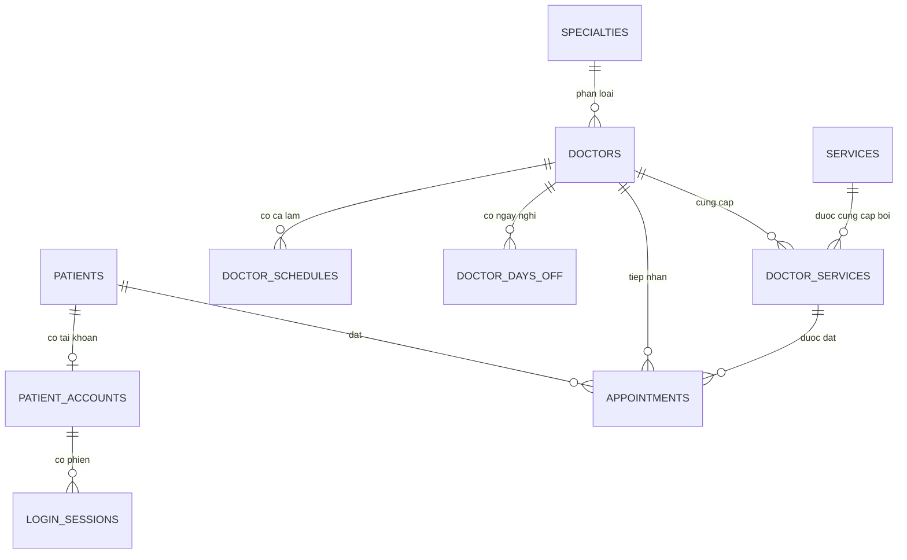

# Đặc tả và thiết kế CSDL

## 02. Yêu cầu: User Story

### Bệnh nhân

| ID | User Story | Tiêu chí chấp nhận |
|---|---|---|
| US-01 | Là khách truy cập, tôi muốn xem dịch vụ, giá, thời lượng và bác sĩ để chọn dịch vụ phù hợp. | Chỉ hiển thị dịch vụ/bác sĩ đang hoạt động. Danh mục xem được mà không cần tài khoản. |
| US-02 | Là bệnh nhân mới, tôi muốn đăng ký tài khoản bằng họ tên, điện thoại, email và mật khẩu để dùng dịch vụ trực tuyến. | Email không trùng; số điện thoại đúng định dạng; mật khẩu tối thiểu 10 ký tự và được băm trước khi lưu. |
| US-03 | Là bệnh nhân, tôi muốn đăng nhập và đăng xuất an toàn để truy cập dữ liệu cá nhân. | API tạo phiên ngẫu nhiên, gửi trong cookie `HttpOnly`, và thu hồi phiên khi đăng xuất. |
| US-04 | Là bệnh nhân đã đăng nhập, tôi muốn đặt lịch bằng hồ sơ tài khoản của mình để không phải nhập lại thông tin. | Máy chủ lấy `patient_id` từ phiên đăng nhập; kiểm tra thời gian tương lai, ca làm, ngày nghỉ và lịch trùng; lịch mới ở trạng thái `pending`. |
| US-05 | Là bệnh nhân, tôi muốn xem lịch hẹn riêng của mình để theo dõi tình trạng thăm khám. | Truy vấn luôn có điều kiện `appointments.patient_id = patient_id` của phiên; không nhận patient ID từ trình duyệt. |
| US-06 | Là bệnh nhân, tôi muốn hủy lịch sắp tới của mình khi không thể đến khám. | Chỉ tài khoản sở hữu lịch mới hủy được lịch tương lai ở trạng thái `pending` hoặc `confirmed`; lịch người khác được phản hồi như không tìm thấy. |

### Phạm vi bản MVP

Đã triển khai US-01 đến US-06. Giao diện nhân viên và quyền staff/admin chưa
được cung cấp; nếu cần thì phải bổ sung role và API quản trị riêng, không dùng
API bệnh nhân.

## 03. Thiết kế: sơ đồ CSDL quan hệ



### Bảng và vai trò

| Bảng | Khóa chính | Vai trò |
|---|---|---|
| `specialties` | `specialty_id` | Danh mục chuyên khoa. |
| `doctors` | `doctor_id` | Bác sĩ; `specialty_id` là khóa ngoại đến chuyên khoa. |
| `patients` | `patient_id` | Hồ sơ bệnh nhân và thông tin liên hệ. Email (nếu có) là duy nhất; nhiều thành viên gia đình có thể dùng chung số điện thoại. |
| `patient_accounts` | `account_id` | Một tài khoản đăng nhập liên kết duy nhất đến một bệnh nhân; email đăng nhập duy nhất, mật khẩu chỉ lưu dưới dạng bcrypt hash. |
| `login_sessions` | `session_id` | Phiên đăng nhập; lưu SHA-256 của token ngẫu nhiên chứ không lưu token gốc. Có thời gian hết hạn. |
| `services` | `service_id` | Danh mục dịch vụ khám. |
| `doctor_services` | `(doctor_id, service_id)` | Bảng kết hợp N-N bác sĩ/dịch vụ; lưu riêng thời lượng và giá theo từng bác sĩ. |
| `doctor_schedules` | `schedule_id` | Ca làm lặp theo thứ trong tuần, gồm giờ bắt đầu/kết thúc. |
| `doctor_days_off` | `day_off_id` | Ngày bác sĩ nghỉ cả ngày. |
| `appointments` | `appointment_id` | Lịch hẹn, bệnh nhân, bác sĩ, dịch vụ, thời gian, trạng thái và ghi chú. |

### Quan hệ và khóa ngoại

- Một chuyên khoa có nhiều bác sĩ (1:N).
- Một bệnh nhân có tối đa một tài khoản (1:0..1), tài khoản có thể có nhiều
  phiên đăng nhập (1:N).
- Bác sĩ và dịch vụ có quan hệ nhiều-nhiều. `doctor_services` chuyển quan hệ
  này thành hai quan hệ 1:N và mang các thuộc tính phụ thuộc vào cặp đó: giá,
  thời lượng.
- Một bệnh nhân, bác sĩ hoặc dịch vụ có thể xuất hiện trong nhiều lịch hẹn (1:N).
- `appointments` có khóa ngoại ghép `(doctor_id, service_id)` đến
  `doctor_services`, đảm bảo lịch không thể đặt dịch vụ mà bác sĩ đó không cung cấp.
- `patient_accounts.patient_id` là `UNIQUE` và khóa ngoại đến `patients`;
  `login_sessions.account_id` là khóa ngoại đến `patient_accounts`.
- `ON DELETE RESTRICT` bảo toàn dữ liệu lịch sử. Với lịch làm/ngày nghỉ, xóa bác
  sĩ có thể xóa các bản ghi con theo `CASCADE`, nhưng không xóa được bác sĩ đã
  được tham chiếu bởi lịch hẹn.

### Cô lập dữ liệu tài khoản

- Khi đăng nhập, server sinh token ngẫu nhiên 256-bit. Cookie gửi về trình duyệt
  có cờ `HttpOnly` và `SameSite=Lax`; DB chỉ lưu `SHA-256(token)` cùng hạn dùng.
- Middleware kiểm tra hash token trong `login_sessions`, rồi dựng user từ quan
  hệ account → patient. Route xem lịch lọc bằng `req.user.patientId` của server.
- Route đặt lịch không nhận `patientId`, họ tên hoặc số điện thoại từ client;
  procedure được gọi với patient ID đã xác thực. Route hủy cập nhật theo cả
  `appointment_id` và patient ID của phiên.
- Khi cần kết thúc mọi phiên của một account, xóa các dòng `login_sessions`
  tương ứng; cookie HttpOnly khiến JavaScript phía client không thể đọc token.

### Ý nghĩa các trường đáng chú ý

- `start_at`, `end_at`: thời gian bắt đầu/kết thúc. Kết thúc được tính từ thời
  lượng dịch vụ lúc đặt, không để frontend tự quyết định.
- `status`: `pending`, `confirmed`, `completed`, `cancelled`, `no_show`.
  Lịch `cancelled` và `no_show` không giữ chỗ khi kiểm tra trùng.
- `service_name_snapshot`, `duration_minutes_snapshot`, `price_snapshot`:
  bản chụp dịch vụ tại thời điểm đặt; thay đổi giá/danh mục sau này không làm
  sai lịch sử.
- `created_at`, `updated_at`: thời điểm tạo và cập nhật lịch.

### Chuẩn hóa, kiểu dữ liệu, chỉ mục

- Danh mục chuyên khoa, bác sĩ, dịch vụ và bệnh nhân không bị lặp lại trong
  mỗi lịch hẹn. Bảng kết hợp tách thuộc tính giá/thời lượng vốn phụ thuộc vào
  cả bác sĩ lẫn dịch vụ.
- `DECIMAL(10,2)` lưu tiền chính xác; `DATETIME` lưu giờ hẹn; `BOOLEAN` dùng
  cho cờ hoạt động; `ENUM` giới hạn trạng thái/giới tính hợp lệ ở DB.
- Chỉ mục lịch hẹn theo `(doctor_id, start_at, status)` phục vụ tìm lịch bác sĩ
  và kiểm tra trùng; `(patient_id, start_at, status)` phục vụ lịch bệnh nhân.
- Chỉ mục bảng lịch làm, ngày nghỉ và cặp dịch vụ hỗ trợ các phép tra cứu khi
  kiểm tra yêu cầu đặt lịch.

## DB scripts

File [clinic_appointment.sql](../clinic_appointment.sql) tạo database, các bảng,
khóa ngoại, chỉ mục, `CHECK`, procedure và dữ liệu mẫu. Các ràng buộc `CHECK`
đảm bảo thời lượng dương, giá không âm, thứ trong tuần hợp lệ và giờ bắt đầu
nhỏ hơn giờ kết thúc.

Ứng dụng gọi `sp_create_appointment` để kiểm tra và ghi lịch. Procedure khóa
bản ghi bác sĩ (và bệnh nhân) trong transaction, đọc thời lượng/giá hiện tại,
kiểm tra lịch làm/ngày nghỉ, rồi dò xung đột thời gian:

```sql
existing.start_at < new_end_at
AND existing.end_at > new_start_at
```

Hai khoảng chỉ chạm biên (ví dụ lịch trước kết thúc 09:30, lịch sau bắt đầu
09:30) được xem là không trùng. Nếu kiểm tra thất bại, procedure phát lỗi
`SQLSTATE '45000'` và rollback.

### Chạy và kiểm tra thủ công

1. Database mới: chạy toàn bộ `clinic_appointment.sql`. Database cũ: chạy
   `migrations/001_patient_accounts.sql` một lần để thêm hai bảng auth mà không
   xóa dữ liệu lịch.
2. Tạo `.env` từ `.env.example`, cấu hình MySQL, rồi chạy `npm install` và
   `npm run dev`.
3. Gọi `GET /api/health`; đúng khi trả `{"status":"ok","database":"connected"}`.
4. Đăng ký hai tài khoản A và B; đặt lịch bằng A rồi xác nhận lịch xuất hiện
   trong mục “Lịch hẹn của tôi”.
5. Đăng xuất và đăng nhập B; xác nhận lịch của A không xuất hiện.
6. Gửi `PATCH /api/appointments/{id-cua-A}/cancel` khi đang đăng nhập B; API
   phải trả `404`. Gọi `GET /api/appointments` khi chưa đăng nhập phải trả `401`.
7. Thử đặt lịch giao nhau với lịch đã có để xác nhận procedure từ chối.

Mã thứ trong `doctor_schedules` theo `DAYOFWEEK()` của MySQL: 1 là Chủ nhật,
2 là thứ Hai, ..., 7 là thứ Bảy.
